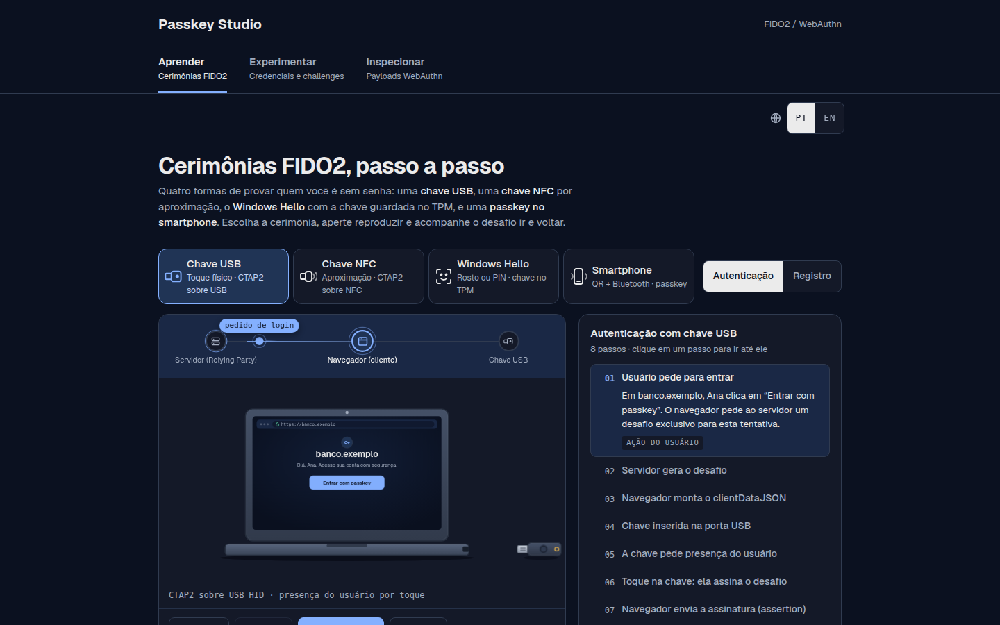
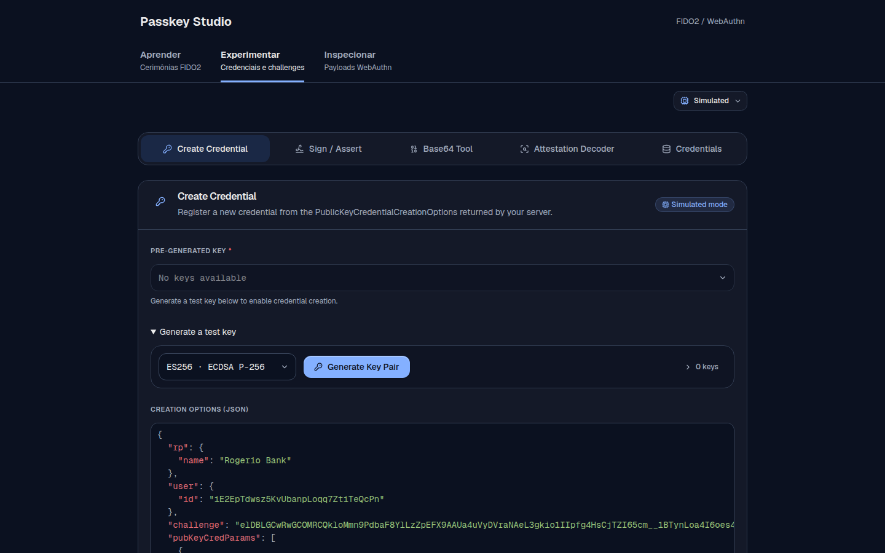
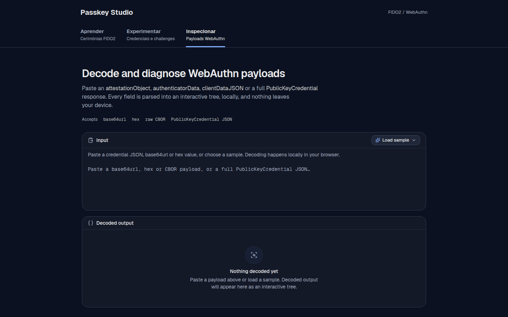

<div align="center">
  

  # Passkey Studio

  *Learn, experiment, and inspect FIDO2 and WebAuthn in your browser*

  [](https://github.com/jrogeriosilva/passkey-studio/actions/workflows/ci.yml)
  [](https://jrogeriosilva.github.io/passkey-studio/)
  [](https://nodejs.org)
  [](https://react.dev)
  [](https://www.typescriptlang.org)

  [Overview](#overview) • [Features](#features) • [Getting Started](#getting-started) • [Usage](#usage) • [Architecture](#architecture) • [Deployment](#deployment)

  <br />

  
</div>

**Passkey Studio** is a single-page web application for developers and integrators working with **FIDO2** and **WebAuthn**. It unifies an interactive ceremony visualizer, a protocol test client (supporting both simulated cryptography and real authenticators), and a local payload decoder into a single workspace.

> [!TIP]
> Try Passkey Studio directly in your browser at **[jrogeriosilva.github.io/passkey-studio](https://jrogeriosilva.github.io/passkey-studio/)** — no installation required.

## Overview

Working with WebAuthn often requires switching between specification diagrams, browser credential APIs, and binary/CBOR decoders. Passkey Studio brings these workflows together across three areas that share navigation, state, and direct payload handoff:

| Area | Route | Purpose | Source |
| :--- | :--- | :--- | :--- |
| **Learn** *(FIDO2 Demo)* | `/fido2-demo/` | Step-by-step visual walkthroughs of registration and authentication ceremonies, plus an interactive payload guide. | `src/features/learn/` |
| **Experiment** *(FIDO2 Lab)* | `/fido2-lab/` | Create credentials and sign server challenges using either browser-simulated keys (`SubtleCrypto`) or real WebAuthn authenticators. | `src/features/lab/` |
| **Inspect** *(WebAuthn Decoder)* | `/webauthn-decoder/` | Decode and inspect `PublicKeyCredential` JSON envelopes, `attestationObject`, `authenticatorData`, `clientDataJSON`, raw CBOR, and Base64url data. | `src/features/inspector/` |

Switching between areas preserves in-memory drafts and browser history without reloading the page.

## Features

### 1. Learn — Interactive FIDO2 Ceremonies

- **Three Authenticator Flows**: Compare **USB Security Key** (CTAP2 over USB HID, presence-only non-discoverable credential), **Windows Hello** (platform TPM-backed passkey with local biometric/PIN user verification), and **Smartphone** (hybrid transport via QR code, Bluetooth LE proximity check, and encrypted tunnel).
- **Registration & Authentication**: Step through challenge generation, `clientDataJSON` assembly, authenticator key generation or signing, and Relying Party (RP) server verification.
- **Dual Visualization**: Toggle between a **Real World** 2.5D isometric scene (with full-screen zoom) and an interactive **Sequence** diagram tracing messages across the Server, Browser, and Authenticator.
- **Payload & Architecture Guide**: Built-in reference with interactive diagrams covering the FIDO2 credential lifecycle, `PublicKeyCredential` anatomy, `attestationObject` formats (`packed`, `tpm`, `none`, etc.), and the exact byte layout of `authenticatorData`.

### 2. Experiment — WebAuthn Test Client

<div align="center">
  
</div>

- **Simulated Mode (`SubtleCrypto`)**: Generates real cryptographic key pairs (**ES256** or **RS256**) during registration, builds spec-compliant CBOR `attestationObject` and binary `authenticatorData` payloads, tracks monotonic signature counters (`signCount`), and signs `authenticatorData ‖ SHA-256(clientDataJSON)` without requiring physical hardware.
- **WebAuthn Mode (`navigator.credentials`)**: Delegates registration and assertion signing to the browser's authenticator or passkey provider (hardware security keys, platform authenticators, or synced passkeys).
- **Protocol Validation**: Enforces RP ID matching, `pubKeyCredParams` algorithm checks, `excludeCredentials` / `allowCredentials` filtering, and `userHandle` preservation.
- **One-Click Inspection**: Send any generated registration or authentication response directly to the **Inspect** area via **Inspect this payload**.

> [!WARNING]
> Simulated mode stores unencrypted private keys in your browser's `localStorage` strictly for development and testing. Never use simulated credentials in production.

### 3. Inspect — Local WebAuthn & Base64url Decoder

<div align="center">
  
</div>

- **Automatic Format & Type Detection**: Paste Base64url, Base64, hexadecimal bytes, or JSON. Automatically detects full `PublicKeyCredential` envelopes, `attestationObject`, `authenticatorData`, assertions, `clientDataJSON`, or arbitrary CBOR maps.
- **Deep Binary & Cryptographic Parsing**: Unpacks the 32-byte `rpIdHash`, decodes flag bits (`UP`, `UV`, `BE`, `BS`, `AT`, `ED`), reads the 4-byte big-endian `signCount`, resolves authenticator AAGUIDs against a built-in metadata registry, and translates numeric COSE key labels (`kty`, `alg`, `crv`) into human-readable names.
- **Base64url Utility**: Dedicated tab to encode UTF-8 text or decode Base64url strings into formatted JSON, plain text, or hexadecimal byte dumps.

> [!NOTE]
> All payload decoding and inspection runs locally in browser memory. No credentials, challenges, or payloads are transmitted over the network.

## Getting Started

### Prerequisites

- **[Node.js](https://nodejs.org/) >= 24** (see `.nvmrc`)
- **npm** (included with Node.js)

### Installation & Local Development

1. Clone the repository and install dependencies from the lockfile:

   ```sh
   git clone https://github.com/jrogeriosilva/passkey-studio.git
   cd passkey-studio
   npm ci
   ```

2. Start the Vite development server:

   ```sh
   npm run dev
   ```

3. Open **http://127.0.0.1:5173/** in your browser.

> [!IMPORTANT]
> When using **WebAuthn · Browser authenticator** mode in the **Experiment** area during local development, open the app via **`http://localhost:5173/`** rather than `127.0.0.1` so the browser accepts `localhost` as a valid Relying Party ID (RP ID).

### Available Scripts

| Command | Description |
| :--- | :--- |
| `npm run dev` | Starts the local development server on `http://127.0.0.1:5173/`. |
| `npm run lint` | Runs ESLint across all TypeScript and React modules. |
| `npm test` | Runs the Node.js ceremony test suite (`src/features/learn/tests/*.test.mjs`) and Vitest unit/component tests. |
| `npm run build` | Type-checks with `tsc --noEmit`, builds the production bundle in `dist/`, and generates static route entries. |
| `npm run preview` | Serves the production build locally for verification. |

## Usage

### Testing a Relying Party Server in Experiment

1. Open **Experiment** (`/fido2-lab/`) and choose an **Authenticator mode**:
   - **Simulated · SubtleCrypto** to test registration and assertion flows without hardware.
   - **WebAuthn · Browser authenticator** to invoke a physical security key, platform authenticator, or passkey provider.
2. In **Create credential**, paste the `PublicKeyCredentialCreationOptions` JSON from your server (or click **Restore sample** / **New challenge**), choose **ES256** or **RS256** when in simulated mode, and create the credential.
3. Copy the resulting registration response JSON to verify it against your RP server, or click **Inspect this payload** to examine its decoded `attestationObject` and `clientDataJSON`.
4. Switch to **Sign**, select a stored credential (or provide `allowCredentials`), paste your server's challenge into the authentication options JSON, and generate an assertion signature.

> [!NOTE]
> Deleting a WebAuthn record in the **Credentials** tab only removes local metadata from browser `localStorage`. It does not delete the credential from a hardware or platform authenticator, nor does it revoke the public key on a Relying Party server.

### Deep-Linking & Keyboard Navigation

- **Learn URL Parameters**: Link directly to any ceremony, mode, and step using query parameters, for example:
  `?ceremony=hello&mode=login&step=5` (`ceremony`: `usb` | `hello` | `phone`, `mode`: `register` | `login`).
- **Inspect Sample Payloads**: Load built-in sample payloads via `?sample=publickeycredential-json` or `?sample=publickeycredential-authentication`.
- **Keyboard Shortcuts**:
  - In **Learn**, use <kbd>←</kbd> / <kbd>→</kbd> to step through the ceremony and <kbd>Space</kbd> to play or pause.
  - In **Experiment**, press <kbd>Ctrl</kbd>+<kbd>Enter</kbd> (or <kbd>⌘</kbd>+<kbd>Enter</kbd>) inside the JSON editors to submit registration or signing requests.

## Architecture

Passkey Studio is structured as a single Vite + React 19 + TypeScript application:

```text
passkey-studio/
├── public/                 # Static assets and favicon.svg
├── scripts/
│   └── pages-entries.mjs   # Copies dist/index.html into static route directories
├── src/
│   ├── App.tsx             # Application shell, header navigation, and cross-area routing
│   ├── navigation.ts       # Base-path-aware route helpers (appPath, routePath)
│   ├── inspection.ts       # CustomEvent bridge for sending payloads to Inspect
│   ├── lib/                # Shared UI helpers
│   └── features/
│       ├── learn/          # Ceremony visualizer, isometric scenes, sequence & payload diagrams
│       ├── lab/            # SubtleCrypto simulator, WebAuthn hardware client, credential storage
│       └── inspector/      # CBOR/authData/clientData decoders, AAGUID registry, Base64url tool
└── docs/
    ├── VALIDATION.md       # Automated and browser validation report
    └── screenshots/        # Desktop and mobile captures of all three areas
```

Styles are shared via Tailwind CSS v4 (`src/features/inspector/index.css`) while feature-specific styles in `Learn` and `Experiment` are isolated using CSS `@scope`.

## Deployment

The project is automatically validated and deployed to **GitHub Pages** via [`.github/workflows/ci.yml`](.github/workflows/ci.yml) on every push to `main`.

Because static hosts like GitHub Pages do not support server-side SPA rewrite rules, `scripts/pages-entries.mjs` duplicates `dist/index.html` into `dist/fido2-demo/index.html`, `dist/fido2-lab/index.html`, and `dist/webauthn-decoder/index.html` during `npm run build`. All entry points load the same React bundle under the configured `VITE_BASE_PATH`.

To reproduce and preview the production GitHub Pages build locally:

```sh
VITE_BASE_PATH=/passkey-studio/ npm run build
VITE_BASE_PATH=/passkey-studio/ npm run preview
```
